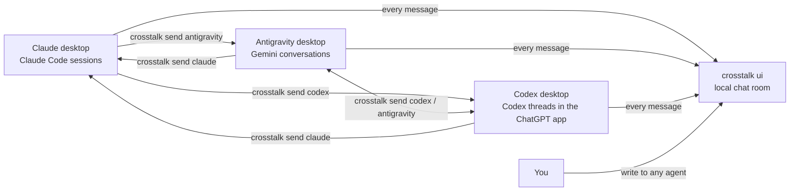

# crosstalk: let Claude, Antigravity and Codex talk to each other

**crosstalk** connects AI coding agents running on your Mac so they can message each other, live, in their
own desktop windows. A Claude desktop (Claude Code) session can hand a task to a Google Antigravity (Gemini)
conversation or an OpenAI Codex thread, they can answer or ask back, and you watch every side as it happens,
or all of it at once in a small local chat room.

- **Desktop to desktop.** Messages land in the real Claude, Antigravity and Codex windows, not in a hidden background run.
- **Find and continue old sessions.** List the open Claude sessions, recent Antigravity conversations and Codex threads, pick one, keep going.
- **Neutral roles.** Either side can be the orchestrator, the worker, a peer to argue with, or just a source of information.
- **Knows who is free.** Every session shows as idle, busy or waiting for you, with the question it asked. crosstalk
  never answers a question meant for you, and if you have an unsent draft it waits until you stop typing,
  sends its message, then puts your draft back.
- **One timeline.** `crosstalk ui` shows every message between agents in one chat view, and you can write into it too.
- **Zero dependencies.** Node.js 22+, under 800 lines, MIT licensed. Nothing runs in the background.



## Install

```bash
npm install -g github:khan-umirzakoff/agent-crosstalk
crosstalk install              # adds the crosstalk skill to Claude, Antigravity and Codex
crosstalk open antigravity     # restarts Antigravity with a local debug port so crosstalk can reach it
crosstalk open codex           # same for the ChatGPT app, switched to Codex mode
```

Requirements: macOS, Node.js 22 or newer, a recent [Claude Code](https://claude.com/claude-code) CLI with
`claude agents --json` (tested with 2.1.328), [Google Antigravity](https://antigravity.google) and, for Codex,
the ChatGPT desktop app with Codex.

## Use it

Talk to your agents normally. The skill teaches them the commands:

> "Ask Antigravity to review the diff in this branch and tell me what it finds."
>
> "You are the orchestrator. Antigravity builds the frontend, you build the API. Agree on the contract first."
>
> "Send the Claude session *billing refactor* the list of failing tests."

Or drive it yourself:

```bash
crosstalk list                                         # who you can reach
crosstalk send antigravity 'API review' 'Check src/api for missing auth checks'
crosstalk send claude 'billing refactor' 'Antigravity found 3 issues, see notes/review.md'
crosstalk status antigravity current                   # busy or idle
crosstalk read antigravity current                     # last answer
crosstalk ui                                           # open the chat room
```

Each message starts with a header such as
`[crosstalk · from claude 'billing refactor' · reply with: crosstalk send claude 'billing refactor' '<reply>']`,
so the receiver always knows who wrote and how to answer.

## Commands

| Command | What it does |
|---|---|
| `crosstalk list [claude\|antigravity\|codex]` | Open Claude sessions, recent Antigravity conversations and Codex threads, with idle / busy / waiting |
| `crosstalk send claude "<session>" <text>` | Message a Claude session by its name |
| `crosstalk send antigravity <target> <text>` | Target: conversation id, its title (or a unique part), `current` or `new` |
| `crosstalk send codex <target> <text>` | Same targets, for Codex threads |
| `crosstalk send user <text>` | Post to the person watching `crosstalk ui` |
| `crosstalk read\|status antigravity\|codex [target]` | Last reply, or whether the agent is busy |
| `crosstalk open antigravity\|codex` | Restart the app with its debug port on `127.0.0.1` (Antigravity 9000, ChatGPT 9001, in Codex mode) |
| `crosstalk ui [--port 4477]` | Local chat room with every message in one timeline |
| `crosstalk log [-n 20]` | Recent messages in the terminal |
| `crosstalk install` / `uninstall` | Add or remove the agent skill |

Text `-` reads the message from stdin: `cat plan.md | crosstalk send antigravity current -`.

## Roles

The skill defines four ways for agents to work together. You pick one in plain words; the default is peers.

| Role | Behaviour |
|---|---|
| Orchestrator | Splits the work, sends tasks with done-criteria, checks the results itself |
| Worker | Does the task, reports the result and what it did not verify |
| Peers | Discuss, challenge each other, agree on one answer |
| Info | Answers the question or sends the data, nothing more |

Agents are told to stop when the task is done (no "thanks" ping-pong) and to make at most 10 round trips without you.

## How it works

- **Antigravity** is an Electron-style app. `crosstalk open antigravity` restarts it with
  `--remote-debugging-port=9000` bound to `127.0.0.1`. crosstalk then uses the Chrome DevTools Protocol to read
  the conversation list, type into the chat box and read the last answer, exactly as you would.
- **Codex** lives in the ChatGPT app, which is Chromium-based too: `crosstalk open codex` gives it a debug
  port on `127.0.0.1:9001` and switches it to Codex mode, and crosstalk drives the Codex thread the same way.
- **Claude** sessions only accept messages from other Claude sessions. crosstalk starts a tiny `claude -p`
  relay (Haiku, about 10 seconds) in safe mode (none of your CLAUDE.md, hooks or plugins) with two tools,
  `ListAgents` and `SendMessage`. The text goes in as data under a fixed system prompt, and crosstalk checks
  afterwards that the relay made exactly one call with the exact text, or reports a failure.
- **States** come from `claude agents --json` and, for what a waiting session asks, from the tail of its
  transcript; Antigravity's state is read from its window (stop button, locked model picker, approval cards).
- **The chat room** is a local web page served on `127.0.0.1`. Every message crosstalk carries is appended to
  `~/.crosstalk/log.jsonl` and streamed to the page.

## Security

- The Antigravity debug port listens on `127.0.0.1` only, but while it is open any program or user account on
  your Mac can drive Antigravity, and so run commands as you. Open Antigravity normally to close it.
- The chat room binds to `127.0.0.1`, checks the `Host` header, refuses to be framed and needs a per-run token
  that is only in the link `crosstalk ui` prints (after `#`), so other web pages and accounts cannot use it.
- A message from another agent is treated as a teammate's request, never as your approval, even when its
  header says "from the user". The skill tells agents to ask you before deploys, payments, deletions or
  permission changes, and never to send secrets. Session names are shell-quoted in reply commands, and
  `--from` must be a conversation id.
- crosstalk does not send while it sees the agent busy or waiting for you, and takes a lock so two senders never
  type at once. An unsent draft in Antigravity is set aside after you stop typing for 2 seconds and put back
  after the message is sent (as plain text: mentions and attachments in a draft are not kept).

## FAQ

**Can Claude Code talk to Google Antigravity?** Yes. That is what crosstalk does: `crosstalk send antigravity`
from Claude, `crosstalk send claude` from Antigravity.

**Why does Claude show "held — waiting for approval"?** Claude Code holds a message when the sending session
runs in a different permission mode than the receiving one. crosstalk's relay runs in the default mode, so a
receiving session in another mode (for example bypass) asks you to approve each message. This is Claude's
safety check; crosstalk does not work around it.

**Does it work with Codex?** Yes, with the Codex mode of the ChatGPT desktop app. `crosstalk open codex`
restarts the app with a local debug port and switches it to Codex mode; crosstalk types into a Codex thread,
reads its answer and its state (a Stop button means busy). Codex agents are recognised by their
`CODEX_THREAD_ID`, so answers go back to the right thread. Codex is careful with messages from other agents
and may ask you to confirm in its chat before it answers; that is Codex's own safeguard.

**Does it cost tokens?** Sending to Claude costs one short Haiku call. Sending to Antigravity costs nothing
extra. The agents themselves use their normal plans.

**Does anything run in the background?** No. Commands run when an agent or you call them. `crosstalk ui`
runs only while it is open.

**What do idle, busy and waiting mean?** Idle: ready for a message. Busy: working; a Claude session reads your
message after its current turn, Antigravity refuses until it is idle. Waiting: the agent asked you something
(a question, a choice, an approval); crosstalk shows the question and refuses to send, so no agent answers
for you.

**Antigravity changed and `crosstalk` cannot find the chat box.** crosstalk reads Antigravity's page through
its `data-testid` attributes, which an update can change. Please open an issue.

## Roadmap

- Wait for a reply: `crosstalk send --wait` that returns the answer to the caller.
- More agents: Cursor, Windsurf, Gemini CLI, any app that exposes its chat to a local debug port.

## License

MIT
