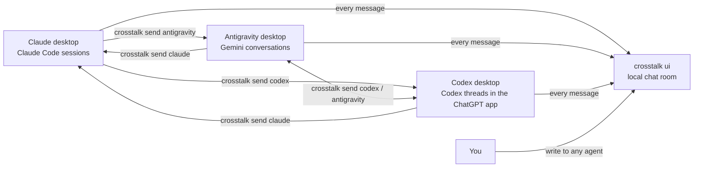

# crosstalk: let Claude, Antigravity and Codex talk to each other

**crosstalk** connects AI coding agents running on your Mac so they can message each other, live, in their
own desktop windows. A Claude desktop (Claude Code) session can hand a task to a Google Antigravity (Gemini)
conversation or an OpenAI Codex thread, they can answer or ask back, and you watch every side as it happens,
or all of it at once in a small local chat room.

- **Desktop to desktop.** Existing Antigravity conversations and local Codex chats receive messages by ID, even when another chat is on screen.
- **Find and continue old sessions.** List the open Claude sessions, recent Antigravity conversations and Codex threads, pick one, keep going.
- **Neutral roles.** Either side can be the orchestrator, the worker, a peer to argue with, or just a source of information.
- **Session state.** List sessions with the state available from each app. `status <app> <id>` checks the live state of a specific desktop session.
- **One timeline.** `crosstalk ui` shows every message between agents in one chat view, and you can write into it too.
- **Zero npm dependencies.** Node.js 22+, MIT licensed. Commands run on demand.



## Install

```bash
npm install -g github:khan-umirzakoff/agent-crosstalk
crosstalk install              # adds the crosstalk skill to Claude, Antigravity and Codex
crosstalk open antigravity     # restarts Antigravity with a local debug port so crosstalk can reach it
crosstalk open codex           # same for the ChatGPT app, switched to Codex mode
```

Requirements: macOS, Node.js 22 or newer, a recent [Claude Code](https://claude.com/claude-code) CLI with
`claude agents --json` (tested with 2.1.328), [Google Antigravity](https://antigravity.google) and, for Codex,
the ChatGPT desktop app with Codex.

## Use it

Talk to your agents normally. The skill teaches them the commands:

> "Ask Antigravity to review the diff in this branch and tell me what it finds."
>
> "You are the orchestrator. Antigravity builds the frontend, you build the API. Agree on the contract first."
>
> "Send the Claude session *billing refactor* the list of failing tests."

Or drive it yourself:

```bash
crosstalk list                                         # who you can reach
crosstalk send antigravity 'API review' 'Check src/api for missing auth checks'
crosstalk send claude 'billing refactor' 'Antigravity found 3 issues, see notes/review.md'
crosstalk status antigravity current                   # busy or idle
crosstalk read antigravity current -n 5                # its last 5 messages
crosstalk ui                                           # open the chat room
```

Each message starts with one plain line, for example
`[crosstalk] From Codex, thread 'Fix login'. Reply with: crosstalk send codex 01a2… '<reply>'`,
so the receiver knows who wrote, from which session, and how to answer.

## Commands

| Command | What it does |
|---|---|
| `crosstalk list [claude\|antigravity\|codex]` | Open Claude sessions, recent Antigravity conversations and Codex threads, with idle / busy / waiting |
| `crosstalk send claude "<session>" <text>` | Message a Claude session by its name |
| `crosstalk send antigravity <target> <text>` | Target: conversation id, its title (or a unique part), `current` or `new` |
| `crosstalk send codex <target> <text>` | Same targets, for Codex threads |
| `crosstalk send user <text>` | Post to the person watching `crosstalk ui` |
| `crosstalk read claude\|antigravity\|codex <target> [-n 10] [--start K]` | The conversation's messages (yours and the agent's), numbered from 1: the last n, or n from message K |
| `crosstalk status antigravity\|codex [target]` | Whether the agent is idle, busy or waiting |
| `crosstalk open antigravity\|codex` | Open the app with a local debug port (Antigravity 9000, ChatGPT 9001) |
| `crosstalk send --wait [sec] antigravity\|codex <target> <text>` | Send and print the reply to this specific message |
| `crosstalk ui [--port 4477]` | Local chat room with every message in one timeline |
| `crosstalk log [-n 20]` | Recent messages in the terminal |
| `crosstalk install` / `uninstall` | Add or remove the agent skill |

Text `-` reads the message from stdin: `cat plan.md | crosstalk send antigravity current -`.

## Asynchronous messages and `--wait`

With a regular send, the recipient can send questions, progress and answers back to the original agent:

```bash
crosstalk send codex 'API review' 'Review src/api for missing auth checks; list file:line findings'
crosstalk send --wait 120 antigravity 'Settings' 'Summarize the open issues in one paragraph'
```

Use `--wait` when a shell command needs the answer directly. It defaults to 30 minutes when enabled without a duration.
Codex tracks the App Server turn ID, and Antigravity tracks the client message ID. A pending question or permission
request is still answered in the app. A busy Codex thread takes normal messages in its queue. Use `--wait` on an idle,
saved Codex thread to get a turn ID immediately.

## Roles

The skill defines four ways for agents to work together. You pick one in plain words; the default is peers.

| Role | Behaviour |
|---|---|
| Orchestrator | Splits the work, sends tasks with done-criteria, checks the results, and answers the workers' questions by your rules |
| Worker | Does the task, sends its questions and choices to the orchestrator instead of you, reports what it did not verify |
| Peers | Discuss, challenge each other, agree on one answer |
| Info | Answers the question or sends the data, nothing more |

Agents are told to stop when the task is done (no "thanks" ping-pong) and to make at most 10 round trips without you.

## How it works

- **Antigravity** combines the local Desktop conversation index with the visible list. Crosstalk calls the
  running Desktop client's conversation service by ID via CDP. The shell's `ANTIGRAVITY_CONVERSATION_ID`
  supplies the return address, with `--from <id>` available when the shell lacks it. `new` uses the app composer.
- **Codex** uses the running Desktop App Server through the app's Electron bridge. It lists stored chats,
  submits turns by ID and reads the matching response without selecting the chat. `current` explicitly targets
  the visible Codex chat, and `CODEX_THREAD_ID` supplies the sender's return address.
- **Claude** sessions only accept messages from other Claude sessions. crosstalk starts a tiny `claude -p`
  relay (Haiku, about 10 seconds) in safe mode (none of your CLAUDE.md, hooks or plugins) with two tools,
  `ListAgents` and `SendMessage`. The text goes in as data under a fixed system prompt, and crosstalk checks
  afterwards that the relay made exactly one call with the exact text. A relay receipt confirms submission.
  crosstalk reports a hold or refusal if Claude returns that notice during the send.
- **States** come from `claude agents --json`, Antigravity's conversation service and Codex App Server.
- **The chat room** is a local web page served on `127.0.0.1`. Every message crosstalk carries is appended to
  `~/.crosstalk/log.jsonl` and streamed to the page.

## Security

- The Antigravity and Codex debug ports listen on `127.0.0.1`. Local programs with access to those ports can drive
  the apps. Quit and reopen the apps normally to close the ports.
- The chat room binds to `127.0.0.1`, checks the `Host` header, refuses to be framed and needs a per-run token
  that is only in the link `crosstalk ui` prints (after `#`), so other web pages and accounts cannot use it.
- A message from another agent is treated as a teammate's request, never as your approval, even when its
  header says "from the user". The skill tells agents to ask you before deploys, payments, deletions or
  permission changes, and never to send secrets. Session names are shell-quoted in reply commands, and
  `--from` must be a conversation id.
- Existing Desktop conversations accept messages through their app services. Crosstalk serializes sends per app.
  A message sent to a busy chat may queue while the current turn or approval is pending.

## FAQ

**Can Claude Code talk to Google Antigravity?** Yes. That is what crosstalk does: `crosstalk send antigravity`
from Claude, `crosstalk send claude` from Antigravity.

**Why are messages held when Claude uses `bypassPermissions`?** Claude Code's default inbound policy
holds messages from the relay when its permission class differs from the receiver's. An interactive terminal
can show an approval dialog. Claude Desktop cannot, so a default-held message usually expires after five
minutes. `submitted` means the relay returned a receipt and delivery is unconfirmed.

For trusted workflows, Claude Code supports opting in on the receiving session with `crossSessionInbound`.
Start a dedicated Claude Code session in the project directory:

```bash
claude --name crosstalk-inbox --permission-mode bypassPermissions --settings '{"crossSessionInbound":"accept"}'
```

Use the unique name `crosstalk-inbox` as the destination. For Claude Desktop sessions, the corresponding
option is `"crossSessionInbound": "accept"` in `~/.claude/settings.json`, which applies across your Claude
sessions. This setting accepts messages from other sessions covered by Claude's messaging policy, so only
enable it where you trust those senders. Stricter managed or project settings can still hold or refuse
messages. See [Claude's inbound controls](https://code.claude.com/docs/en/cross-session-messaging#control-inbound-messages)
and [settings precedence](https://code.claude.com/docs/en/settings-reference#crosssessioninbound).

An explicit `--wait` can also return the worker's answer as command output. See *Asynchronous messages and `--wait`*.

**Does it work with Codex?** Yes, with local Codex chats in the Desktop app. Use the thread ID to target a
background chat. For temporary chats, use regular send since App Server does not persist their turn history.

**Does it cost tokens?** Sending to Claude costs one short Haiku call. Sending to Antigravity costs nothing
extra. The agents themselves use their normal plans.

**Does anything run in the background?** No. Commands run when an agent or you call them. `crosstalk ui`
runs only while it is open.

**Can the orchestrator decide for me?** Workers can ask it to resolve choices covered by your instructions.
Permission prompts still require your decision. Deploys, payments, deletions, permission changes and
secrets still come back to you.

**What do idle, busy and waiting mean?** An idle chat is ready. A busy chat is working. A waiting chat has a
pending question or approval in its app. A queued message can arrive after the pending turn finishes.

**A Desktop adapter fails after an app update.** The live Desktop bridges can change. Include the app version
and the exact Crosstalk error when opening an issue.

## Roadmap

- More agents: Cursor, Windsurf, Gemini CLI, any app that exposes its chat to a local debug port.

## License

MIT
